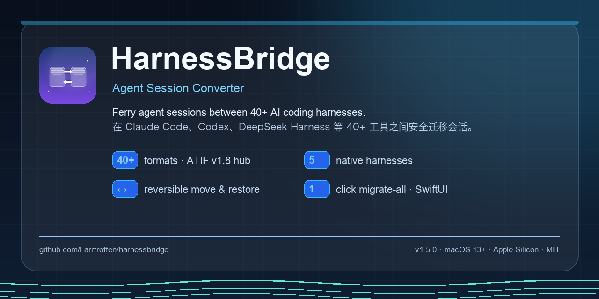
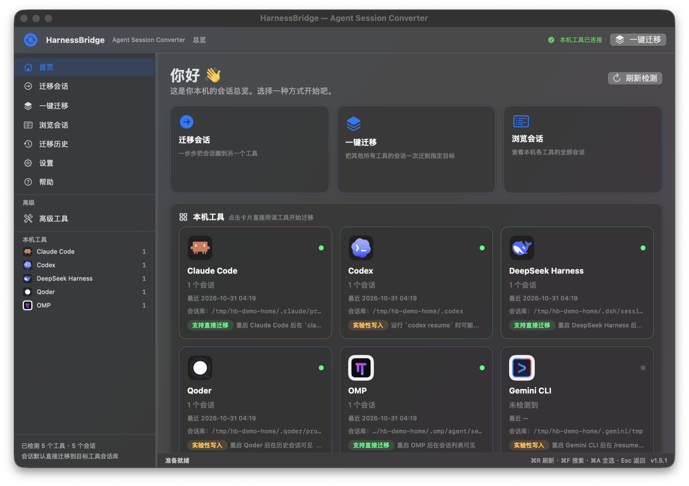
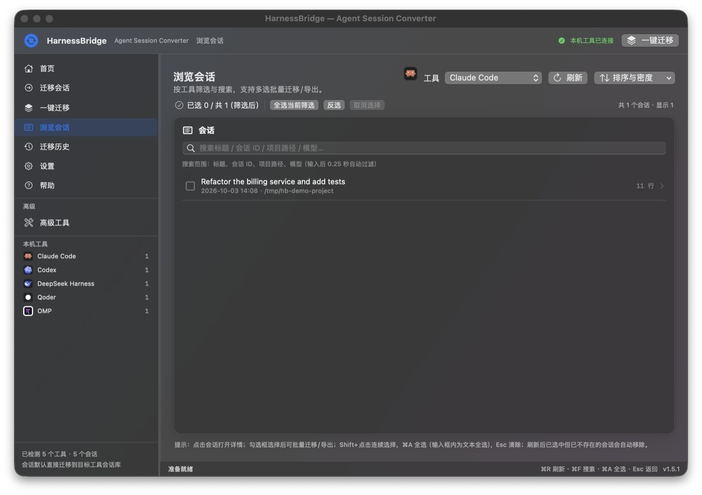
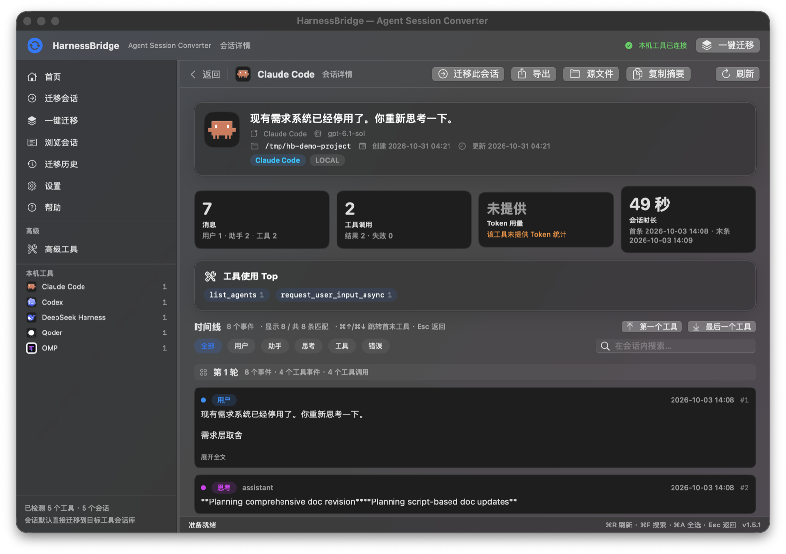
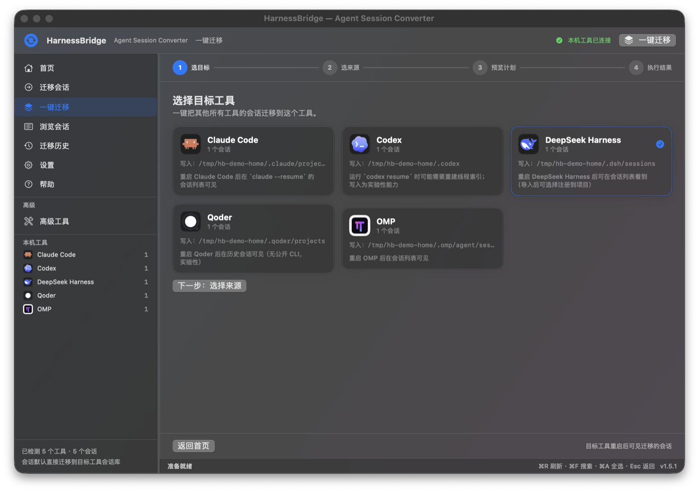
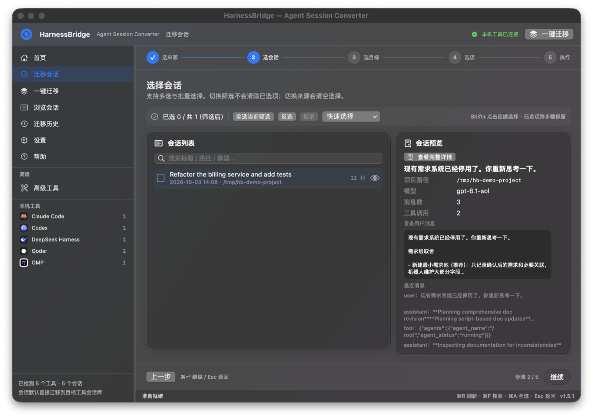
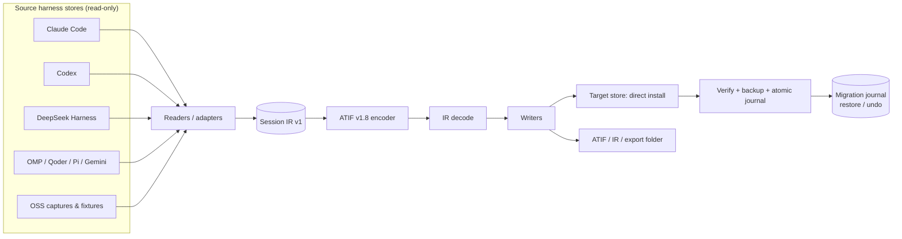

<div align="center">



# HarnessBridge

**Agent Session Converter.** Ferry your AI agent sessions between Claude Code, Codex, DeepSeek Harness, Cursor, OMP, Qoder and 40+ other harnesses — on your Mac, without uploading anything.

[](https://github.com/Larrtroffen/harnessbridge/releases)
[](https://github.com/Larrtroffen/harnessbridge/actions/workflows/ci.yml)


[English](README.md) · [简体中文](README.zh-CN.md) · [Architecture](docs/ARCHITECTURE.md) · [CLI](docs/CLI.md) · [Compatibility](docs/COMPATIBILITY.md) · [FAQ](docs/FAQ.md)

</div>

## Screenshots

| Home | Session browser |
|---|---|
|  |  |

| Session detail & timeline | One-click full migration |
|---|---|
|  |  |

| Migration wizard | |
|---|---|
|  | Screenshots use a temporary demo HOME with constructed sample sessions; no real user data. |

---

## What is HarnessBridge?

HarnessBridge moves **agent session history** between AI coding harnesses. It reads a source harness's native session store, converts it through a versioned intermediate representation (IR) and the open **ATIF v1.8** trajectory format, then writes it into the target harness's own session store — so the target tool can list, resume and inspect the conversation.

It ships as two parts:

| Component | What it is | For whom |
|---|---|---|
| **HarnessBridge.app** | Native SwiftUI macOS app (no Electron, no embedded web view) | People who want a guided, visual migration |
| **`asi` CLI** | Python 3 standard-library command line tool — the app's entire conversion/migration engine | Power users, scripts, CI, people on Linux |

The app contains **no conversion logic of its own**: it is a thin, careful front-end over the CLI, which keeps behaviour auditable and lets both surfaces share the same safety checks.

## Features

- **Direct install by default** — pick a target harness and the session is written into that harness's real local store (auto-detected). No “export to a folder and copy it yourself” detour.
- **Keep or move, always reversible** — `keep` leaves the source untouched; `move` renames the source session to `*.migrated-<timestamp>.bak` **only after** the target install and verification succeed. Nothing is ever deleted, and `asi migrate-restore` (or the app) can move it back.
- **One-click full migration** — `asi migrate-all --to <target>` moves every session from all other detected harnesses, with per-source limits, `--since-days`, dry-run plans, duplicate skipping, backups for overwrites, progress, cancellation, per-session results and a recovery journal.
- **40/40 canonical protocol coverage** — 40 canonical harness formats covered, plus **43 source adapters** (iFlow and Zed are bonus sources) and **32 native writer targets**; ATIF v1.8 remains the hub. See [coverage ledger](docs/coverage-ledger.md) and [external projects research](docs/EXTERNAL-PROJECTS.md).
- **Safety first** — sources are read-only; writing a real store requires `--yes` plus explicit UI confirmation; overwrites create `.asi-backup-*` files; every migration writes an incremental, atomic journal; `--dry-run` performs zero writes.
- **Verification** — DSH targets are checked with the native `verify` reader; other targets are read back through the target reader (or file-level fallback), and results report `installed_path`, `verified` and per-item status.
- **Native experience** — session browser with full-text filter, selection ranges (Shift/⌘A), migration history, session timeline with tool calls, paired results, token statistics, 27 harness logos, Chinese UI, Reduce Motion support.
- **Local only** — no network calls, no telemetry, no accounts. Everything runs on your machine and writes only where you tell it to.

## Supported harnesses

### Direct install (writes into the harness's own store)

| Target | Store (auto-detected, env-overridable) | Support |
|---|---|---|
| **DeepSeek Harness (DSH)** | `~/.dsh/sessions` (`DSH_HOME`) | ✅ Stable — restart DSH to see imported sessions |
| **Claude Code** | `~/.claude/projects` (`CLAUDE_CONFIG_DIR`) | ✅ Stable — `claude --resume` |
| **OMP** | `~/.omp/agent/sessions` (`OMP_SESSION_DIR`) | ✅ Stable — restart OMP |
| **Codex** | `~/.codex` (`CODEX_HOME`) | 🧪 Experimental — may need to rebuild its thread index |
| **Qoder** | `~/.qoder/projects` (`QODER_CONFIG_DIR`) | 🧪 Experimental — restart Qoder |
| **Pi** | `~/.pi/agent/sessions` (`PI_HOME`) | 🧪 Experimental — restart Pi |
| **Gemini CLI** | `~/.gemini/tmp` (`GEMINI_HOME`) | 🧪 Experimental — `/resume` may need a restart |
| **Goose** | SQLite store (`GOOSE_PATH_ROOT`) | 📦 Export-only (no direct install) |

### Read / export coverage

- **Native readers**: Claude Code, Codex, OMP, Qoder, DeepSeek Harness, Pi, Gemini CLI and more.
- **40 canonical harness formats** covered by the interop protocol/adapters, plus bonus **iFlow** and **Zed** readers (43 source adapters, 32 native writers). Evidence levels range from **NATIVE** (real local store + native load) through **REAL-LOCAL**, **COLLECTED**, **REAL**, **REAL-EXAMPLE**, **FIXTURE**, **FIXTURE-LOW** and **CONSTRUCTED**.
- **Latest-version isolation test (v1.6.2)** — installed the missing CLIs in an isolated `$HOME` on a remote Ubuntu host, confirmed their latest versions, and ran each tool's **custom Base URL / OpenAI-compatible configuration against the real DeepSeek API** (`deepseek-flash`). Validated current stores for **Qwen Code 0.26.5, Goose 1.57.0, OpenCode 1.19.5 and iFlow 0.5.19**; OpenCode's v1.19 SQLite store is now parsed natively. These are **LOCAL-DEEPSEEK** samples, not real user conversations; the four coverage numbers are unchanged. Details: [docs/latest-version-matrix.md](docs/latest-version-matrix.md).
- **English + Simplified Chinese localization (v1.7.0)** — the app now ships `en` and `zh-Hans` localization; switch live in **Settings → Interface Language** (Follow System / English / 简体中文). Static and generated UI strings are localized, including menus and backend-provided hints. Official harness logos refreshed from official GitHub organization/repository assets where available. See [docs/INTEL-MAC.md](docs/INTEL-MAC.md) for the previous architecture work.
- **Intel Mac support (v1.6.3)** — per-architecture DMGs: arm64 and **x86_64** (Intel), the latter with an embedded x86_64 Python runtime and cross-compiled x86_64 zstd. Homebrew cask selects automatically. See [docs/INTEL-MAC.md](docs/INTEL-MAC.md).
- **Batch 6 (v1.6.0)** added an external-fixture matrix: **35/40 fixture-verified** canonical labels (34 pass + 6 partial, 0 reader fail), **32/32 native writers pass**, and **22/40 real-session coverage** — we deliberately report these as separate numbers (protocol coverage vs. fixture-verified format coverage vs. real user sessions). See [docs/coverage-ledger.md](docs/coverage-ledger.md), [docs/EXTERNAL-PROJECTS.md](docs/EXTERNAL-PROJECTS.md) and [docs/usage.md §16](docs/usage.md).

> Names and logos are trademarks of their respective owners. HarnessBridge is not affiliated with, endorsed by, or sponsored by any harness vendor. See [THIRD_PARTY_NOTICES.md](THIRD_PARTY_NOTICES.md).

## Install

### Option A — Homebrew (Apple Silicon and Intel)

```bash
brew tap Larrtroffen/harnessbridge
brew trust Larrtroffen/harnessbridge   # Homebrew 7: explicitly trust this tap
brew install --cask harnessbridge
```

The tap lives at [Larrtroffen/homebrew-harnessbridge](https://github.com/Larrtroffen/homebrew-harnessbridge).
The cask picks the self-contained arm64 or x86_64 app for your Mac and prints the Gatekeeper caveat.

### Option B — prebuilt macOS app (Apple Silicon or Intel)

1. Download the matching DMG from [Releases](https://github.com/Larrtroffen/harnessbridge/releases): `HarnessBridge-1.7.0-macos-arm64.dmg` for Apple Silicon or `HarnessBridge-1.7.0-macos-x86_64.dmg` for Intel Macs.
2. Open the DMG and drag **HarnessBridge.app** into `/Applications`.
3. Because the app is **ad-hoc signed (not notarized by Apple)**, Gatekeeper may block the first launch. Either right-click the app → **Open** → confirm, or run:
   ```bash
   xattr -dr com.apple.quarantine /Applications/HarnessBridge.app
   ```
4. Launch HarnessBridge. It requires **macOS 13 (Ventura) or newer**. Intel Macs are supported by the x86_64 DMG; the Intel build is cross-compiled and structurally verified, with an Intel-Mac runtime smoke test still requested in issue #1.
5. **No Python, zstd or repo checkout is required** for the prebuilt app: it bundles its own Python runtime, the `asi` backend and a `zstd` binary inside `HarnessBridge.app`. Only your harness session stores are read/written (when you ask it to migrate).

Each release also publishes a `.zip` and a `SHA256SUMS.txt`; verify before running:
```bash
shasum -a 256 -c SHA256SUMS.txt
```

### Option C — build from source

Requirements: macOS 13+, Xcode Command Line Tools (`swift --version`), Python 3.10+, and the `zstd` CLI (`brew install zstd`) for compressed DeepSeek Harness artifacts.

```bash
git clone https://github.com/Larrtroffen/harnessbridge.git
cd harnessbridge

# 1) CLI (standard library only, no pip installs)
python3 tools/agent-session-import/asi --version
python3 tools/agent-session-import/asi --help

# 2) macOS app (SwiftPM, no Xcode project needed)
cd tools/HarnessBridgeApp
swift build -c release
./build.sh                     # arm64 → dist/HarnessBridge.app + arm64 DMG
./build.sh --intel             # Intel/x86_64 → dist/HarnessBridge.app + x86_64 DMG
open dist/HarnessBridge.app
```

The app bundles the CLI path discovery logic: keep the repository layout intact (`tools/agent-session-import/asi` next to `tools/HarnessBridgeApp`), or point the app at a workspace in Settings.

## Quick start

### GUI (5 steps)

1. **Launch** HarnessBridge → the welcome/overview screen detects harnesses and session counts locally.
2. **迁移会话 / Migrate** → choose a **source** harness and one or more sessions.
3. Choose a **target** harness. The card shows the exact store path that will be written and how to see the sessions afterwards.
4. Choose whether to **keep** the source (default) or **move** it out (recoverable, second confirmation required), then confirm the write location.
5. Watch per-session progress, then review the result: installed path, verification, skipped duplicates, journal, and a **“恢复被移出的会话 / Restore moved sessions”** button.

Use **一键迁移 / Migrate all** for a full migration: pick a target, keep the default “all other harnesses” sources (or exclude some), preview the dry-run plan (zero writes), and confirm.

### CLI

```bash
ASI=./tools/agent-session-import/asi

# What is installed and where do its sessions live?
"$ASI" detect --json

# List sessions (read-only)
"$ASI" list claude --json
"$ASI" list dsh --limit 20 --json

# Preview a session summary (read-only)
"$ASI" preview --from claude --session <session-id> --json

# The classic safety-first path: convert/export to a folder
"$ASI" convert --from codex --session <session-id> --to atif --out ~/Documents/HarnessBridgeOut

# Direct install into the target harness store (needs --yes)
"$ASI" migrate --from claude --session <session-id> --to dsh --yes --register --json

# Direct install + move the source out (recoverable)
"$ASI" migrate --from codex --session <session-id> --to omp --yes --session-mode move --json

# One-click full migration — always preview first
"$ASI" migrate-all --to dsh --limit 10 --session-mode keep --dry-run --json
"$ASI" migrate-all --to dsh --limit 10 --session-mode keep --yes --json

# Undo the move (source comes back; target install stays unless you pass --remove-installed)
"$ASI" migrate-restore --journal "<journal-path-from-results>" --json
```

Every command supports `--json` for automation, and `--dry-run` where a plan exists. Exit codes are stable: `0` success, non-zero failure, and install without `--yes` refuses and exits with a distinct error.

## Architecture



Deeper details — adapter contract, evidence levels, safety invariants and repository layout — are in [docs/ARCHITECTURE.md](docs/ARCHITECTURE.md).

## Safety, privacy and limitations

- **Read-only sources.** HarnessBridge never edits or deletes source sessions; `move` is a reversible rename after a verified install.
- **Writes need consent.** Real-store installs require `--yes` on the CLI and an explicit confirmation in the app that shows the destination store path. `--dry-run` never writes, creates no directories and no journal.
- **Backups & journals.** Overwrites first move the existing target to `*.asi-backup-<timestamp>`; each migration/restore operation writes an atomic, incremental journal; the `journal_path` field returned by the CLI/app is authoritative. App data lives under `~/Library/Application Support/HarnessBridge/`; the CLI backend writes journals under `~/Library/Application Support/HarnessBridge/journals/`; the old SessionConverter folder is read-only compatibility. Restore never deletes the installed target copy unless asked.
- **No network, no telemetry.** The app and CLI do not phone home; no API keys or accounts are required.
- **App identity / local data.** Bundle id `io.github.larrtroffen.harnessbridge`; app data (history, detect cache, journals) lives in `~/Library/Application Support/HarnessBridge/`, default export folder `~/Documents/HarnessBridgeOut/`.
- **Lossy by nature.** Not every harness feature has an ATIF equivalent (images/audio, harness-private events, some tool-call pairings). Conversions may be marked `lossy` with explicit warnings; we do not claim “100% lossless.”
- **ATIF is a trajectory format, not a resume format.** Migrated sessions give the target tool conversation history; they do not reconstruct the source agent's private runtime/checkpoint state.
- **Experimental targets.** Codex/Qoder/Pi/Gemini writers are marked experimental; the target tool may need a restart or index rebuild, and behaviour can vary between harness versions.
- **Gatekeeper.** Release artifacts are ad-hoc signed, not Apple-notarized. Right-click → Open (or clear the quarantine attribute) on first launch; macOS will warn that the developer cannot be verified.
- **Back up your data once more.** Even with dry-runs, verification and journals, this is tooling that writes to other tools' stores. Keep a Time Machine backup before your first large migration.

More in [SECURITY.md](SECURITY.md) and [docs/FAQ.md](docs/FAQ.md).

## Documentation

| Document | English | 中文 |
|---|---|---|
| Architecture | [docs/ARCHITECTURE.md](docs/ARCHITECTURE.md) | [docs/ARCHITECTURE.zh-CN.md](docs/ARCHITECTURE.zh-CN.md) |
| CLI reference | [docs/CLI.md](docs/CLI.md) | [docs/CLI.zh-CN.md](docs/CLI.zh-CN.md) |
| Compatibility matrix | [docs/COMPATIBILITY.md](docs/COMPATIBILITY.md) | [docs/COMPATIBILITY.zh-CN.md](docs/COMPATIBILITY.zh-CN.md) |
| FAQ | [docs/FAQ.md](docs/FAQ.md) | [docs/FAQ.zh-CN.md](docs/FAQ.zh-CN.md) |
| App manual (internal, Chinese) | [docs/swift-app.md](docs/swift-app.md) | — |
| Backend deep dive (internal) | [docs/usage.md](docs/usage.md) | — |
| ATIF interop protocol | [docs/atif-interop-protocol.md](docs/atif-interop-protocol.md) | — |
| Coverage ledger | [docs/coverage-ledger.md](docs/coverage-ledger.md) | — |
| External projects & fixtures | [docs/EXTERNAL-PROJECTS.md](docs/EXTERNAL-PROJECTS.md) | — |
| Latest-version isolation test | [docs/latest-version-matrix.md](docs/latest-version-matrix.md) | — |
| Intel Mac support | [docs/INTEL-MAC.md](docs/INTEL-MAC.md) | — |
| Localization | `Localization/en.lproj`, `Localization/zh-Hans.lproj` | — |
| Release notes | [RELEASE_NOTES/v1.7.0.md](RELEASE_NOTES/v1.7.0.md) | [RELEASE_NOTES/v1.7.0.zh-CN.md](RELEASE_NOTES/v1.7.0.zh-CN.md) |

## Roadmap

- v1.5.x — polish the first public release: notarization/Developer ID for smoother Gatekeeper, more screenshots/docs, bug fixes from early adopters.
- v1.7 — closer to 40/40 real-session coverage (install/run more harnesses locally), more native writers, per-session diff/preview before install.
- Later — optional Linux CLI packaging, richer ATIF round-trips, and a documented plugin interface for new readers/writers.

Roadmap items are intentions, not commitments; priorities follow user reports.

## Contributing

Issues and PRs are welcome — especially **new harness adapters** with fixtures, docs corrections, and translations. Please read [CONTRIBUTING.md](CONTRIBUTING.md) and the [Code of Conduct](CODE_OF_CONDUCT.md), and report security issues privately per [SECURITY.md](SECURITY.md).

- Run the public fixture tests (private/local-data tests are skipped automatically):
  `python3 -m unittest discover -s tools/agent-session-import/tests -p 'test_*.py' -v`
- Run the app self-test: `tools/HarnessBridgeApp/dist/HarnessBridge.app/Contents/MacOS/HarnessBridge --self-test`
- Never write to a real harness store in tests: use a temporary `HOME` and the documented env overrides.

## License

MIT — see [LICENSE](LICENSE). Copyright (c) 2026 Xinhua Li (Larrtroffen).

ATIF is specified by the Harbor project (RFC 0001, Apache-2.0); harness names/logos belong to their respective owners. Full attributions in [THIRD_PARTY_NOTICES.md](THIRD_PARTY_NOTICES.md).

> **Name note:** this project is `Larrtroffen/harnessbridge`. An unrelated project with the same name exists on GitHub (`mandyyyyii/HarnessBridge`); HarnessBridge here is not affiliated with it.
