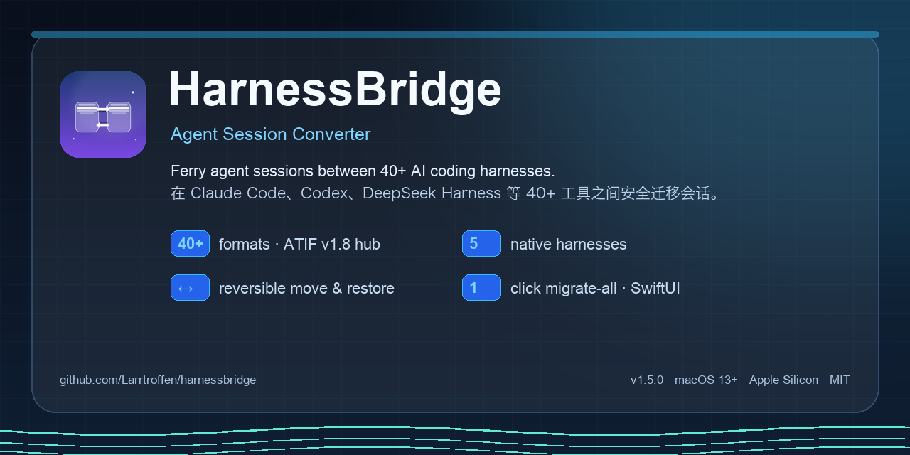
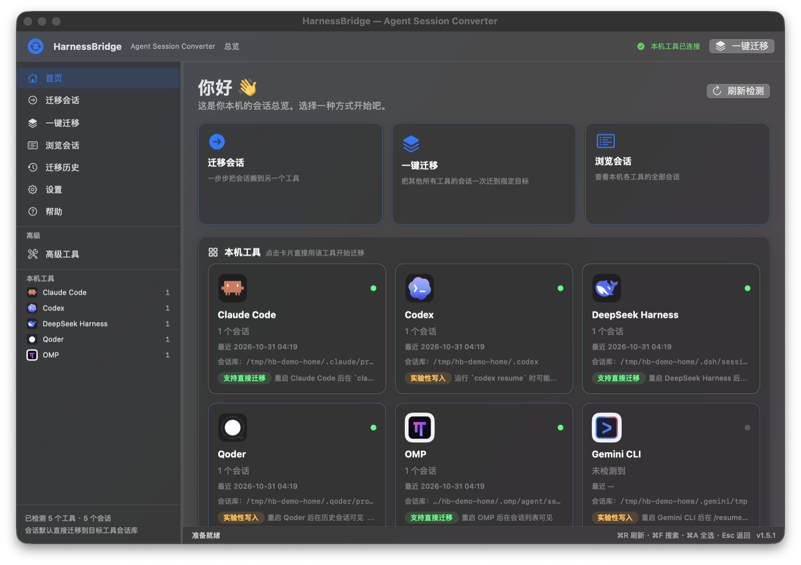
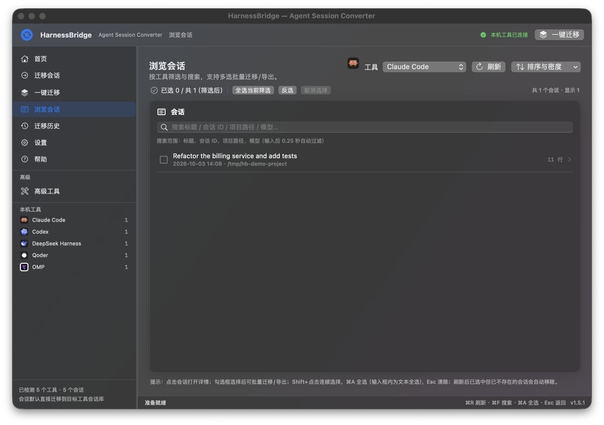
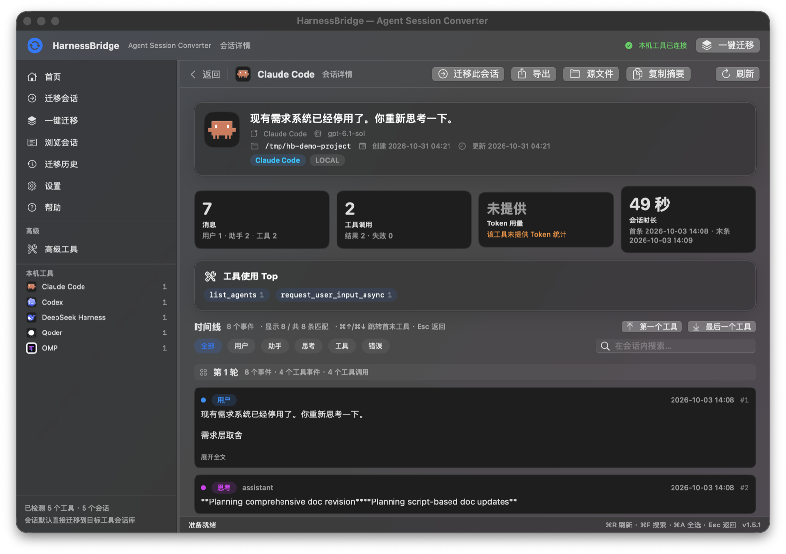
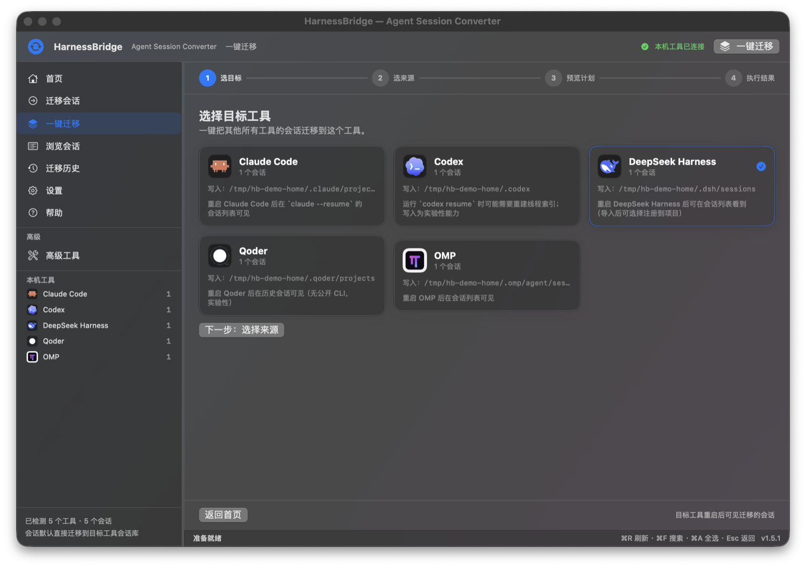
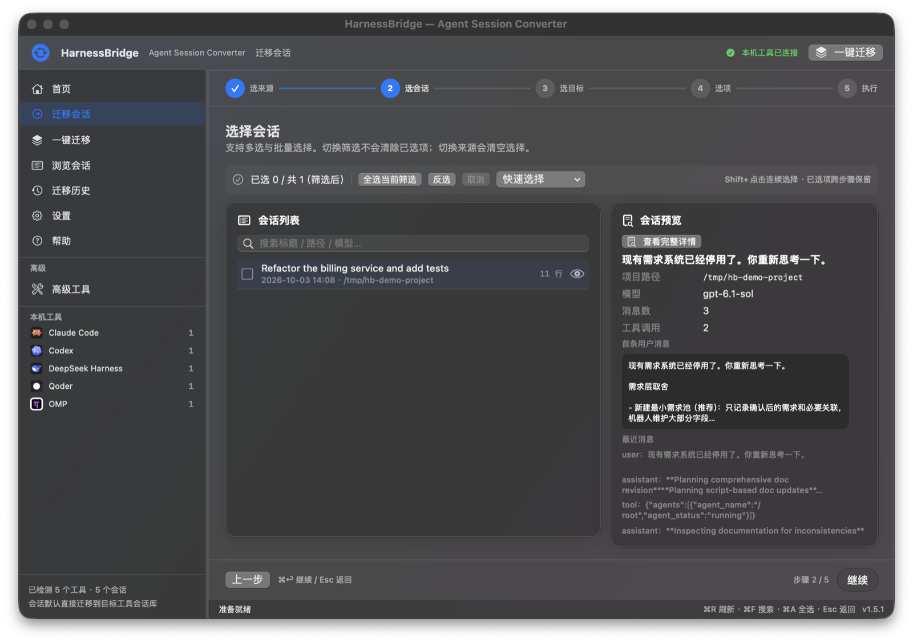
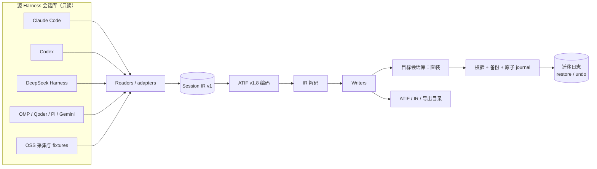

<div align="center">



# HarnessBridge

**Agent Session Converter（会话桥）。** 在 Claude Code、Codex、DeepSeek Harness、Cursor、OMP、Qoder 等 40+ 个 AI 编程 Harness 之间摆渡会话历史——全部在本机完成，不上传任何数据。

[](https://github.com/Larrtroffen/harnessbridge/releases)
[](https://github.com/Larrtroffen/harnessbridge/actions/workflows/ci.yml)


[English](README.md) · [简体中文](README.zh-CN.md) · [架构](docs/ARCHITECTURE.zh-CN.md) · [CLI](docs/CLI.zh-CN.md) · [兼容性](docs/COMPATIBILITY.zh-CN.md) · [FAQ](docs/FAQ.zh-CN.md)

</div>

## 界面截图

| 首页 | 会话浏览 |
|---|---|
|  |  |

| 会话详情与时间线 | 一键全量迁移 |
|---|---|
|  |  |

| 迁移向导 | |
|---|---|
|  | 截图使用临时演示 HOME 与合成样本会话，不含真实用户数据。 |

---

## HarnessBridge 是什么？

HarnessBridge 负责在不同 AI 编程 Harness 之间搬移 **Agent 会话历史**：读取源 Harness 的原生会话库，经版本化的中间表示（IR）与开放的 **ATIF v1.8** 轨迹格式转换，再写入目标 Harness 自己的会话库——这样目标工具能够列出、恢复并查看这段对话。

项目由两部分组成：

| 组件 | 说明 | 适合谁 |
|---|---|---|
| **HarnessBridge.app** | 原生 SwiftUI macOS 应用（无 Electron、无内嵌网页） | 希望有可视化引导、一步步完成迁移的用户 |
| **`asi` CLI** | 仅用 Python 3 标准库实现的命令行工具，也是 App 的全部转换/迁移引擎 | 高级用户、脚本、CI、Linux 用户 |

App 本身**不包含转换逻辑**：它只是 CLI 之上的一层克制、可审计的前端；两者共享同一套安全语义，行为一致。

## 功能特性

- **默认直装目标会话库**：选择目标 Harness 后，会话直接写入该工具真实的本机会话库（自动检测路径），不再要求“先导出到文件夹再自己拷”。
- **保留 / 移出原始会话，永远可恢复**：`keep`（默认）完全不动源会话；`move` 只在**目标安装且校验成功之后**，把源会话改名为 `*.migrated-<时间戳>.bak`——绝不删除，可随时用 `asi migrate-restore` 或 App 恢复。
- **一键全量迁移**：`asi migrate-all --to <目标>` 把其他所有已检测 Harness 的会话一次迁完，支持逐来源数量上限、`--since-days` 时间过滤、dry-run 计划、重复跳过、覆盖前备份、进度、取消、逐条结果与恢复日志。
- **40/40 canonical 协议覆盖**：40 种 canonical Harness 格式全部有 adapter，另有 **43 个 source adapter**（iFlow、Zed 为 bonus source）与 **32 个原生 writer 目标**；以 ATIF v1.8 为中枢。详见[覆盖账本](docs/coverage-ledger.md)与[外部项目调研](docs/EXTERNAL-PROJECTS.md)。
- **安全优先**：源会话只读；写真实 store 必须 `--yes` + UI 二次确认并展示写入位置；覆盖先备份 `.asi-backup-*`；每次迁移写**增量、原子** journal；`--dry-run` 零写入。
- **安装后校验**：DSH 目标用原生 `verify` 读回；其他目标用目标 reader 读回（或文件级兜底）；结果含 `installed_path`、`verified` 与逐条状态。
- **原生体验**：会话浏览与筛选、Shift/⌘A 范围选择、迁移历史、会话时间线与工具调用配对、Token 统计、27 个 Harness Logo、中文界面、Reduce Motion 支持。
- **完全本地**：无网络请求、无遥测、无账号；只在你指定的位置读写。

## 支持的 Harness

### 直装（写入 Harness 自己的会话库）

| 目标 | store（自动检测，可 env 覆盖） | 支持级别 |
|---|---|---|
| **DeepSeek Harness（DSH）** | `~/.dsh/sessions`（`DSH_HOME`） | ✅ 稳定 — 重启 DSH 后可见 |
| **Claude Code** | `~/.claude/projects`（`CLAUDE_CONFIG_DIR`） | ✅ 稳定 — `claude --resume` 可见 |
| **OMP** | `~/.omp/agent/sessions`（`OMP_SESSION_DIR`） | ✅ 稳定 — 重启 OMP 可见 |
| **Codex** | `~/.codex`（`CODEX_HOME`） | 🧪 实验性 — 可能需要重建线程索引 |
| **Qoder** | `~/.qoder/projects`（`QODER_CONFIG_DIR`） | 🧪 实验性 — 重启 Qoder 可见 |
| **Pi** | `~/.pi/agent/sessions`（`PI_HOME`） | 🧪 实验性 — 重启 Pi 可见 |
| **Gemini CLI** | `~/.gemini/tmp`（`GEMINI_HOME`） | 🧪 实验性 — `/resume` 可能需要重启 |
| **Goose** | SQLite 库（`GOOSE_PATH_ROOT`） | 📦 仅导出，不支持直装 |

### 读取 / 导出覆盖

- **原生 reader**：Claude Code、Codex、OMP、Qoder、DeepSeek Harness、Pi、Gemini CLI 等。
- **40 种 canonical Harness 格式**全部有 adapter，另有 bonus **iFlow**、**Zed** reader（共 **43 个 source adapter**、32 个原生 writer）。证据等级包括 **NATIVE**、**REAL-LOCAL**、**COLLECTED**、**REAL**、**REAL-EXAMPLE**、**FIXTURE**、**FIXTURE-LOW**、**CONSTRUCTED**。
- **最新版本隔离测试（v1.6.2）**：在远程 Ubuntu 主机的隔离 `$HOME` 中安装缺失 CLI，确认最新版本，并通过各自的自定义 Base URL / OpenAI-compatible 配置接入**真实 DeepSeek API**（`deepseek-flash`）。验证 **Qwen Code 0.26.5、Goose 1.57.0、OpenCode 1.19.5、iFlow 0.5.19** 的当前 store；OpenCode v1.19 SQLite store 已原生支持。这些是 **LOCAL-DEEPSEEK** 样本，不是真实用户会话，四个覆盖数字不变。详见 [docs/latest-version-matrix.md](docs/latest-version-matrix.md)。
- **批 6（v1.6.0）**新增外部 fixture 矩阵：**35/40 fixture-verified**（34 pass + 6 partial，0 reader fail）、**32/32 原生 writer 通过**、**真实会话覆盖 22/40**。三个数字刻意分开报告：协议覆盖 / fixture 验证覆盖 / 真实用户会话覆盖。详见[覆盖账本](docs/coverage-ledger.md)、[外部项目调研](docs/EXTERNAL-PROJECTS.md)与 [docs/usage.md §16](docs/usage.md)。

> 名称与 Logo 的商标归各自所有者。HarnessBridge 与任何 Harness 厂商均无关联、背书或赞助关系。详见 [THIRD_PARTY_NOTICES.md](THIRD_PARTY_NOTICES.md)。

## 安装

### 方式 A — Homebrew（Apple Silicon）

```bash
brew tap Larrtroffen/harnessbridge
brew trust Larrtroffen/harnessbridge   # Homebrew 7 需要显式信任第三方 tap
brew install --cask harnessbridge
```

Tap 仓库：[Larrtroffen/homebrew-harnessbridge](https://github.com/Larrtroffen/homebrew-harnessbridge)。
安装的是自带运行时的 arm64 App，Homebrew 会打印 Gatekeeper 提示。

### 方式 B — 预编译 macOS 应用（Apple Silicon）

1. 从 [Releases](https://github.com/Larrtroffen/harnessbridge/releases) 下载 `HarnessBridge-1.6.2-macos-arm64.dmg`。
2. 打开 DMG，把 **HarnessBridge.app** 拖进 `/Applications`。
3. 应用是 **ad-hoc 签名、未做 Apple 公证**，首次启动可能被 Gatekeeper 拦截。右键 App → **打开** → 确认，或执行：
   ```bash
   xattr -dr com.apple.quarantine /Applications/HarnessBridge.app
   ```
4. 启动 HarnessBridge。要求 **macOS 13（Ventura）或更新版本**；预编译 DMG 为 Apple Silicon（arm64），Intel Mac 请从源码构建。
5. **预编译版无需 Python、zstd，也无需 clone 仓库**：App 内已自带 Python 运行时、`asi` 后端与 `zstd` 二进制；只有在你主动迁移时才会读写目标/来源 Harness 的会话库。

每个 Release 同时提供 `.zip` 与 `SHA256SUMS.txt`，运行前建议校验：
```bash
shasum -a 256 -c SHA256SUMS.txt
```

### 方式 C — 从源码构建

依赖：macOS 13+、Xcode Command Line Tools（`swift --version`）、Python 3.10+；如需处理 DeepSeek Harness 的 zstd 产物，还需要 `zstd` CLI（`brew install zstd`）。

```bash
git clone https://github.com/Larrtroffen/harnessbridge.git
cd harnessbridge

# 1) CLI（纯标准库，无需 pip 安装）
python3 tools/agent-session-import/asi --version
python3 tools/agent-session-import/asi --help

# 2) macOS App（SwiftPM，无需 Xcode 工程）
cd tools/HarnessBridgeApp
swift build -c release
./build.sh                     # → dist/HarnessBridge.app（ad-hoc 签名）
open dist/HarnessBridge.app
```

App 通过仓库目录结构自动定位 CLI：保持 `tools/agent-session-import/asi` 与 `tools/HarnessBridgeApp` 的相对位置；也可以在设置里手动指定工作区。

## 快速开始

### GUI（5 步）

1. **启动** HarnessBridge：欢迎/总览页会在本地检测已安装 Harness 与会话数。
2. 点 **迁移会话** → 选择**来源** Harness 与会话（可多选）。
3. 选择**目标** Harness：目标卡片会显示将写入的真实 store 路径，以及迁移后如何查看。
4. 选择**保留原始**（默认）或**移出原始**（可恢复，需二次确认），确认写入位置。
5. 查看逐会话进度与结果：安装路径、校验状态、跳过重复、journal，以及 **「恢复被移出的会话」** 按钮。

想一次迁完所有来源时用 **一键迁移**：选目标 → 默认勾选“其他所有 Harness”来源（可排除/筛选）→ 预览计划（零写入）→ 确认执行。

### CLI

```bash
ASI=./tools/agent-session-import/asi

# 本机装了哪些 Harness、会话库在哪？
"$ASI" detect --json

# 列出会话（只读）
"$ASI" list claude --json
"$ASI" list dsh --limit 20 --json

# 预览会话摘要（只读）
"$ASI" preview --from claude --session <session-id> --json

# 最保守的路径：转换/导出到文件夹
"$ASI" convert --from codex --session <session-id> --to atif --out ~/Documents/HarnessBridgeOut

# 直装到目标会话库（必须 --yes）
"$ASI" migrate --from claude --session <session-id> --to dsh --yes --register --json

# 直装 + 移出源会话（可恢复）
"$ASI" migrate --from codex --session <session-id> --to omp --yes --session-mode move --json

# 一键全量迁移——先预览
"$ASI" migrate-all --to dsh --limit 10 --session-mode keep --dry-run --json
"$ASI" migrate-all --to dsh --limit 10 --session-mode keep --yes --json

# 撤销 move（源会话回来；目标安装默认保留；加 --remove-installed 才删除）
"$ASI" migrate-restore --journal "<结果里的 journal-path>" --json
```

所有命令均支持 `--json`，有计划的命令支持 `--dry-run`。退出码稳定：`0` 成功、非零失败；install 缺少 `--yes` 会明确拒绝并返回错误。

## 架构



Adapter 契约、证据等级、安全不变量与仓库结构详见[架构文档](docs/ARCHITECTURE.zh-CN.md)。

## 安全、隐私与限制

- **源会话只读。** HarnessBridge 从不编辑/删除源会话；`move` 是「安装+校验成功后」的可恢复改名。
- **写入需要明确同意。** 真实 store 安装需要 CLI 的 `--yes` 与 App 中展示写入位置的二次确认。`--dry-run` 不写任何文件、不建目录、不写 journal。
- **备份与日志。** 覆盖前先把既有目标改名为 `*.asi-backup-<时间戳>`；每次迁移/恢复写原子、增量 journal；CLI/App 返回的 `journal_path` 才是权威位置。App 数据位于 `~/Library/Application Support/HarnessBridge/`；CLI 后端默认 journal 目录已统一为 `~/Library/Application Support/HarnessBridge/journals/`（旧 SessionConverter 目录仅作读取兼容）。除非显式要求，恢复不会删除已安装的目标副本。
- **零网络、零遥测。** App 与 CLI 不联网，不需要 API key 或账号。
- **App 标识与本地数据。** Bundle id `io.github.larrtroffen.harnessbridge`；App 数据（历史、检测缓存、journal）在 `~/Library/Application Support/HarnessBridge/`，默认导出目录 `~/Documents/HarnessBridgeOut/`。
- **格式本身存在有损。** 并非所有 Harness 特性都有 ATIF 等价表达（图像/音频、私有事件、部分工具调用配对等）；转换可能带 `lossy` 警告，我们不宣称“100% 无损”。
- **ATIF 是轨迹格式，不是 resume 格式。** 迁移提供的是对话历史，不重建源 Agent 的私有运行时/checkpoint 状态。
- **实验性目标。** Codex/Qoder/Pi/Gemini 写入为实验性；目标工具可能需要重启或重建索引，且行为可能随 Harness 版本变化。
- **Gatekeeper。** Release 产物为 ad-hoc 签名、未经 Apple 公证，首次启动需右键打开或清除 quarantine 属性，macOS 会提示“无法验证开发者”。
- **请自行再做一层备份。** 即使有 dry-run、校验与 journal，这仍是会写其他工具 store 的工具；大规模迁移前建议保留 Time Machine 备份。

更多见 [SECURITY.md](SECURITY.md) 与 [FAQ](docs/FAQ.zh-CN.md)。

## 文档

| 文档 | English | 中文 |
|---|---|---|
| 架构 | [docs/ARCHITECTURE.md](docs/ARCHITECTURE.md) | [docs/ARCHITECTURE.zh-CN.md](docs/ARCHITECTURE.zh-CN.md) |
| CLI 参考 | [docs/CLI.md](docs/CLI.md) | [docs/CLI.zh-CN.md](docs/CLI.zh-CN.md) |
| 兼容性矩阵 | [docs/COMPATIBILITY.md](docs/COMPATIBILITY.md) | [docs/COMPATIBILITY.zh-CN.md](docs/COMPATIBILITY.zh-CN.md) |
| FAQ | [docs/FAQ.md](docs/FAQ.md) | [docs/FAQ.zh-CN.md](docs/FAQ.zh-CN.md) |
| App 手册（内部，中文） | [docs/swift-app.md](docs/swift-app.md) | — |
| 后端深入（内部） | [docs/usage.md](docs/usage.md) | — |
| ATIF 互转协议 | [docs/atif-interop-protocol.md](docs/atif-interop-protocol.md) | — |
| 覆盖账本 | [docs/coverage-ledger.md](docs/coverage-ledger.md) | — |
| 外部项目与 fixture | [docs/EXTERNAL-PROJECTS.md](docs/EXTERNAL-PROJECTS.md) | — |
| 最新版本隔离测试 | [docs/latest-version-matrix.md](docs/latest-version-matrix.md) | — |
| 版本说明 | [RELEASE_NOTES/v1.6.2.md](RELEASE_NOTES/v1.6.2.md) | [RELEASE_NOTES/v1.6.2.zh-CN.md](RELEASE_NOTES/v1.6.2.zh-CN.md) |

## 路线图

- v1.5.x — 打磨首个公开版本：补充截图、Homebrew tap、修复早期用户反馈；签名/公证为可选后续项。
- v1.6 — 更深度的原生 writer（用真实本机会话验证更多 Harness）、更准确的 Token 口径、安装前的逐会话预览/对比。
- 更远期 — 可选的 Linux CLI 打包、更丰富的 ATIF round-trip、面向新 reader/writer 的插件接口文档。

路线图是意图而非承诺，优先级以用户反馈为准。

## 参与贡献

欢迎 Issue 与 PR——尤其是**带 fixture 的新 Harness adapter**、文档修正与翻译。请先读 [CONTRIBUTING.md](CONTRIBUTING.md) 与[行为准则](CODE_OF_CONDUCT.md)；安全问题请按 [SECURITY.md](SECURITY.md) 私下报告。

- 跑公开 fixture 测试（依赖本机数据的测试会自动 skip）：
  `python3 -m unittest discover -s tools/agent-session-import/tests -p 'test_*.py' -v`
- 跑 App 自检：`tools/HarnessBridgeApp/dist/HarnessBridge.app/Contents/MacOS/HarnessBridge --self-test`
- 测试**绝不**写真实 Harness store：使用临时 `HOME` 与文档中的 env 覆盖。

## 许可证

MIT — 见 [LICENSE](LICENSE)。Copyright (c) 2026 Xinhua Li (Larrtroffen)。

ATIF 由 Harbor 项目（RFC 0001，Apache-2.0）制定；Harness 名称/Logo 归各自所有者。完整署名见 [THIRD_PARTY_NOTICES.md](THIRD_PARTY_NOTICES.md)。

> **名称说明：** 本项目为 `Larrtroffen/harnessbridge`。GitHub 上另有一个同名但无关的项目（`mandyyyyii/HarnessBridge`），本项目与其无任何关联。
