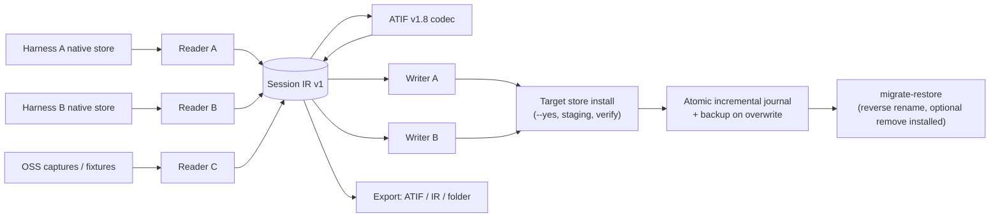

# Architecture

> Audience: contributors and curious users. For the complete adapter/evidence specification see the project's internal [`atif-interop-protocol.md`](atif-interop-protocol.md) and [`usage.md`](usage.md) (Chinese).

## 1. Design goals

HarnessBridge exists because AI coding harnesses store conversation history in mutually incompatible formats. Its architecture is shaped by four constraints:

1. **Do not lose user data.** Source stores are read-only; writes are explicit, verified and reversible.
2. **One hub, not N×N converters.** Every reader produces a common **Session IR**; every writer consumes it. A new harness adds one adapter instead of N conversions.
3. **Auditable behaviour.** The SwiftUI app contains no conversion logic; the Python CLI is the single engine, so a migration does exactly what the CLI does.
4. **Open interchange.** IR encodes to/from **[ATIF v1.8](https://github.com/harbor-framework/harbor/blob/main/rfcs/0001-trajectory-format.md)** (Harbor RFC 0001, Apache-2.0), a public trajectory format, so history is inspectable outside this project.

## 2. Pipeline



### 2.1 Readers

A reader knows **where** a harness stores sessions and **how** to turn one session into IR. Readers are read-only and must never write inside a harness store.

- Default roots are resolved from environment overrides first (`CLAUDE_CONFIG_DIR`, `CODEX_HOME`, `DSH_HOME`, `OMP_SESSION_DIR`, `QODER_CONFIG_DIR`, `PI_HOME`, `GEMINI_HOME`, `GOOSE_PATH_ROOT`, …) and fall back to the documented macOS locations.
- `asi list <source>` enumerates sessions; `preview` and `session-detail` read without converting; `detect` inspects availability and install capabilities.

### 2.2 Session IR v1

IR is the loss-tolerant internal model: session metadata (id, title, cwd, timestamps, model), an ordered event timeline (user/assistant/thinking/tool call/tool result), token/usage statistics, and warnings.

Rules that keep conversions honest:
- Unknown or harness-private data is preserved as warnings/lossy notes rather than silently dropped;
- Each conversion reports `lossy` entries and per-event `quality` where applicable;
- ATIF-specific features that have no harness equivalent are recorded, not invented.

### 2.3 ATIF v1.8

ATIF is the open trajectory interchange format (Harbor RFC 0001, v1.8, maintained by the Harbor project under Apache-2.0). It serves as the hub for cross-harness conversion and as a first-class export target.

Important nuance: **ATIF is a trajectory log format, not a harness resume format.** It carries the conversation, not the private runtime/checkpoint state an agent needs to continue exactly where it left off. Migrated sessions give the target tool readable history; they do not guarantee “same agent state”.

### 2.4 Writers

Writers materialize IR into a target harness's native layout. Two modes:

- **Export** (`asi convert --to <fmt> --out <dir>` / `asi migrate --mode export`): writes files under a user-chosen folder. Safest, always available.
- **Install** (`asi migrate --mode install`, the default when the target supports it): writes into the target harness's real local store. Requires `--yes`, supports `--dry-run`, staging and verification.

Writer support levels are declared in the harness catalog: `install_supported` (stable), `install_experimental` (experimental), or export-only.

## 3. Command layers

| Layer | Surface | Examples |
|---|---|---|
| Detection | `asi detect --json [--fast|--deep]` | store paths, counts, capabilities, how-to-see hints |
| Read | `asi list`, `asi preview`, `asi session-detail` | read-only inspection |
| Convert | `asi convert`, `asi import` | IR/ATIF/native output, optional DSH install |
| Migrate | `asi migrate`, `asi migrate-all` | direct install, keep/move, overwrite, journal |
| Undo | `asi migrate-restore` | reverse source rename, optional remove installed |
| Verify | `asi verify` | DSH artifact integrity (header/seq/surface/pairing) |
| Matrices | `asi matrix*` | interop regression evidence |

The macOS app calls this CLI through a Process bridge and parses the stable `--json` envelopes.

## 4. Safety invariants

These are implementation invariants, enforced by code and tests — not merely recommendations:

1. **Read-only sources.** Readers never modify source stores.
2. **`--dry-run` performs zero writes** — no target files, no directories, no journal.
3. **Real-store writes need `--yes`.** Without it the CLI refuses and exits non-zero; the app asks for explicit confirmation showing the destination store path.
4. **Install is staged + verified.** Data is written to a temporary file/directory first, atomically moved into place, then verified with the target reader (DSH: native `verify`). Failed verification rolls back files/directories created by this run and restores any overwrite backup.
5. **Overwrites back up first.** Existing target sessions are renamed to `*.asi-backup-<timestamp>` before replacement (only with `--overwrite`; default is skip).
6. **Move is a rename, never a delete.** With `--session-mode move`, the source file becomes `*.migrated-<timestamp>.bak` only after a successful verified install. Directory/multi-file sources are reported `unsupported` and left untouched.
7. **Journal is atomic and incremental.** Every completed session appends one entry via temp-file + `fsync` + `os.replace`; journal names are collision-free (millisecond + random suffix). Interrupted batches keep the recovery map for completed items.
8. **Restore is explicit.** `asi migrate-restore` reverses the source rename from the journal; it deletes the installed target copy only with `--remove-installed`.
9. **No network.** Neither app nor CLI performs network requests or telemetry.

## 5. Repository layout

```text
harnessbridge/
├── README.md / README.zh-CN.md     # project entry points
├── docs/                          # architecture, CLI, compatibility, FAQ, deep internals
│   └── assets/                    # banner and logos preview
├── tools/
│   ├── agent-session-import/      # `asi` CLI + readers/writers/IR/ATIF/adapters/tests
│   │   ├── asi                    # Python 3 stdlib entry point
│   │   └── agent_session_import/  # implementation
│   ├── HarnessBridgeApp/          # SwiftUI macOS app (SwiftPM)
│   │   ├── Sources/               # SwiftPM target sources
│   │   ├── Assets/                # icon + 27 harness logos
│   │   └── build.sh               # release build + bundle + ad-hoc codesign
│   └── coverage-report.py          # coverage ledger generator/checker
├── samples/                       # captured/fixture sessions used by tests and docs
├── assets/harness-logos/          # source-of-truth logos + SOURCE.md licence manifest
├── legacy-python-gui/             # early developer web GUI (history; not shipped)
├── research/                      # design research and evidence notes
└── .github/workflows/             # CI + release automation
```

## 6. Platform and dependencies

- **App**: Swift 6 / SwiftUI, macOS 13+, built with SwiftPM (`swift build -c release`), bundled by `build.sh`, ad-hoc signed (not notarized).
- **CLI**: Python 3.10+, standard library only. The optional `zstd` CLI (BSD-3-Clause) is used for compressed DSH artifacts and can be bypassed with `--no-zstd`.
- **No third-party Swift packages or Python packages** are required to build/run; see [THIRD_PARTY_NOTICES.md](../THIRD_PARTY_NOTICES.md).

## 7. Extending the project

1. Add a reader: place it under `tools/agent-session-import/agent_session_import/readers/` with a `default_root`, `list_sessions`, `load_session`. Register it in the harness catalog.
2. Add a writer: under `writers/`, emitting the native layout. Declare `install_supported`/`install_experimental` only when the layout and verification are understood.
3. Add fixtures: put sanitized, redistributable samples under `samples/` and document provenance; never commit real user secrets or personal paths.
4. Add tests: unit tests must run with a temporary `HOME` and env-overridden stores; never against a real user store.
5. Update [COMPATIBILITY.md](COMPATIBILITY.md) with evidence level, limitations and lossy notes.

See [CONTRIBUTING.md](../CONTRIBUTING.md) for the workflow and PR expectations.
