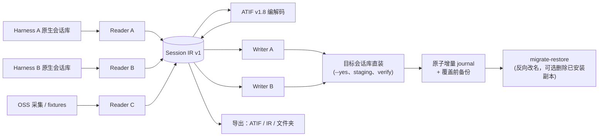

# 架构说明

> 面向：贡献者与好奇的用户。完整 adapter/证据规范见项目内部的 [`atif-interop-protocol.md`](atif-interop-protocol.md) 与 [`usage.md`](usage.md)。

## 1. 设计目标

AI 编程 Harness 的会话格式互不兼容，HarnessBridge 的架构由四条约束决定：

1. **不能弄丢用户数据。** 源会话库只读；写入必须显式、可校验、可恢复。
2. **一个中枢，而不是 N×N 个转换器。** 每个 reader 产出一致的 **Session IR**，每个 writer 消费它；接一个新 Harness 只需一个 adapter。
3. **行为可审计。** SwiftUI App 不含转换逻辑，Python CLI 是唯一引擎：一次迁移做的事与 CLI 完全一致。
4. **开放互转。** IR 可编码为 **[ATIF v1.8](https://github.com/harbor-framework/harbor/blob/main/rfcs/0001-trajectory-format.md)**（Harbor RFC 0001，Apache-2.0）并解码回来，因此历史轨迹可被本工具之外检查。

## 2. 流水线



### 2.1 Reader（读取器）

Reader 知道某个 Harness **把会话存在哪里**、以及如何把单个会话变成 IR。Reader 只读，绝不写 Harness 会话库。

- 默认根路径优先读环境变量覆盖（`CLAUDE_CONFIG_DIR`、`CODEX_HOME`、`DSH_HOME`、`OMP_SESSION_DIR`、`QODER_CONFIG_DIR`、`PI_HOME`、`GEMINI_HOME`、`GOOSE_PATH_ROOT` 等），再回退到文档中的 macOS 默认位置。
- `asi list <source>` 枚举会话；`preview`/`session-detail` 只读查看；`detect` 检查可用性与安装能力。

### 2.2 Session IR v1

IR 是容忍有损的内部模型：会话元数据（id、标题、cwd、时间、model）、按序事件时间线（用户/助手/思考/工具调用/工具结果）、Token/用量统计与 warning。

保证转换诚实的原则：
- 未知/私有数据以 warning/lossy 记录，而不是静默丢弃；
- 每次转换输出 `lossy` 列表与逐事件质量标注；
- 没有 Harness 对应物的 ATIF 特性只记录，不臆造。

### 2.3 ATIF v1.8

ATIF 是开放的轨迹互转格式（Harbor RFC 0001，v1.8，由 Harbor 项目维护，Apache-2.0）。它既是跨 Harness 转换中枢，也是一等导出目标。

重要区分：**ATIF 是轨迹日志格式，不是 Harness 的 resume 格式。** 它携带对话内容，不携带 Agent 私有运行时/checkpoint 状态。迁移后的会话给目标工具可读的历史，但不保证“Agent 状态一模一样”。

### 2.4 Writer（写出器）

Writer 把 IR 落成目标 Harness 的原生布局，两种模式：

- **导出**（`asi convert --to <fmt> --out <dir>` / `asi migrate --mode export`）：写到用户选择的文件夹，最安全、始终可用。
- **直装**（`asi migrate --mode install`，目标支持时默认）：写入目标 Harness 真实会话库；需要 `--yes`，支持 `--dry-run`、staging 与校验。

Writer 支持级别在 Harness 目录中声明：`install_supported`（稳定）、`install_experimental`（实验性）、或仅导出。

## 3. 命令分层

| 层 | 表面 | 示例 |
|---|---|---|
| 检测 | `asi detect --json [--fast|--deep]` | store 路径、数量、能力、查看方式 |
| 读取 | `asi list`、`asi preview`、`asi session-detail` | 只读查看 |
| 转换 | `asi convert`、`asi import` | IR/ATIF/原生输出，可选 DSH 安装 |
| 迁移 | `asi migrate`、`asi migrate-all` | 直装、keep/move、overwrite、journal |
| 撤销 | `asi migrate-restore` | 反向恢复源会话，可选删除已安装副本 |
| 校验 | `asi verify` | DSH 产物完整性（header/seq/surface/pairing） |
| 矩阵 | `asi matrix*` | 互转回归证据 |

macOS App 通过 Process 桥调用这些 CLI，并解析稳定的 `--json` 信封。

## 4. 安全不变量

以下由代码与测试强制，不是口头建议：

1. **源只读。** Reader 不修改源会话库。
2. **`--dry-run` 零写入**：不落目标文件、不建目录、不写 journal。
3. **真实写入必须 `--yes`。** 缺失时 CLI 拒绝并非零退出；App 中会弹出展示目标 store 路径的二次确认。
4. **直装先 staging 后校验。** 先写临时文件/目录，再原子落位，然后用目标 reader 校验（DSH 用原生 `verify`）。校验失败回滚本次新建文件/目录，并恢复覆盖前备份。
5. **覆盖先备份。** 仅 `--overwrite` 时把既有目标改名为 `*.asi-backup-<时间戳>`；默认跳过。
6. **move 是改名，绝不删除。** `--session-mode move` 仅在安装+校验成功后把源文件改为 `*.migrated-<时间戳>.bak`；目录/多文件型源报告 `unsupported`，完全不动源。
7. **journal 原子且增量。** 每完成一个会话即通过临时文件 + `fsync` + `os.replace` 追加；日志名毫秒+随机后缀避免碰撞；中断的批次保留已完成项的恢复映射。
8. **恢复必须显式。** `asi migrate-restore` 按 journal 反向恢复源文件；只有 `--remove-installed` 才删除已安装的目标副本。
9. **无网络。** App 与 CLI 均不发网络请求、不做遥测。

## 5. 仓库结构

```text
harnessbridge/
├── README.md / README.zh-CN.md     # 项目入口
├── docs/                          # 架构、CLI、兼容性、FAQ 与深入内部文档
│   └── assets/                    # banner 与 logo 预览
├── tools/
│   ├── agent-session-import/      # `asi` CLI + readers/writers/IR/ATIF/adapters/tests
│   │   ├── asi                    # Python 3 标准库入口
│   │   └── agent_session_import/  # 实现
│   ├── HarnessBridgeApp/          # SwiftUI macOS App（SwiftPM）
│   │   ├── Sources/               # SwiftPM target sources
│   │   ├── Assets/                # 图标 + 27 个 Harness Logo
│   │   └── build.sh               # release 构建 + bundle + ad-hoc 签名
│   └── coverage-report.py          # 覆盖账本生成/校验脚本
├── samples/                       # 测试/文档使用的采集与 fixture 会话
├── assets/harness-logos/          # Logo 事实源 + SOURCE.md 许可清单
├── legacy-python-gui/             # 早期开发者 Web GUI（历史保留，不随产品发布）
├── research/                      # 设计调研与证据笔记
└── .github/workflows/             # CI + 发布自动化
```

## 6. 平台与依赖

- **App**：Swift 6 / SwiftUI，macOS 13+；SwiftPM 构建（`swift build -c release`），`build.sh` 打包，ad-hoc 签名（未公证）。
- **CLI**：Python 3.10+，仅标准库。可选 `zstd` CLI（BSD-3-Clause）用于 DSH 压缩产物；可用 `--no-zstd` 绕过。
- 构建/运行**不需要**任何第三方 Swift 或 Python 包；见 [THIRD_PARTY_NOTICES.md](../THIRD_PARTY_NOTICES.md)。

## 7. 如何扩展

1. 新增 reader：放到 `tools/agent-session-import/agent_session_import/readers/`，实现 `default_root`、`list_sessions`、`load_session`，并在 Harness 目录注册。
2. 新增 writer：放到 `writers/`，产出原生布局；只有在布局与校验方式都清楚时才声明 `install_supported`/`install_experimental`。
3. 新增 fixture：把可再分发、已脱敏的样本放到 `samples/`，记录来源；绝不提交真实用户密钥或私有路径。
4. 新增测试：必须使用临时 `HOME` 与 env 覆盖的 store；绝不写真实用户 store。
5. 更新[兼容性文档](COMPATIBILITY.zh-CN.md)：证据等级、限制与有损说明。

贡献流程与 PR 要求见 [CONTRIBUTING.md](../CONTRIBUTING.md)。
